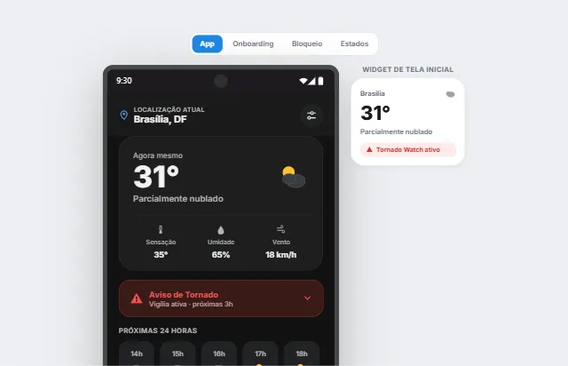

<p align="center">
  
</p>

<h1 align="center">Sereno</h1>

> Previsão do tempo, alertas e horta, sem complicação.

*Sereno* é a umidade que cai à noite e também quer dizer calma. O app tenta ser as duas coisas.

App de previsão do tempo para Android e iOS feito com **React Native + Expo**. Ele mostra as condições atuais, a previsão hora a hora e semanal, um radar de chuva animado, alertas de tempo severo com notificação e uma aba de **cultivo** que sugere atividades ao ar livre e dias bons para plantar.

Usa **apenas APIs gratuitas e sem chave**: dá para clonar e rodar sem configurar nada.

<p align="center">
  
  <br />
  <sub>Protótipo de design das telas (pasta <code>design/</code>)</sub>
</p>

---

## Funcionalidades

| Aba / tela | O que faz |
| --- | --- |
| **Hoje** | Condição atual, sensação térmica, umidade e vento; faixa das próximas 24 horas; card de detalhes (índice UV, qualidade do ar, direção do vento, ponto de orvalho, pressão e visibilidade). |
| **Semanal** | Próximos 7 dias com chance de chuva e uma barra de mínima/máxima na mesma escala da semana. |
| **Alertas** | Alerta estimado de granizo, tempestade ou rajadas para as próximas 6 horas, com recomendações, compartilhamento e notificação local. |
| **Mapa** | Radar de precipitação animado (passado e próximos minutos) sobre o mapa, com camadas de alerta e de locais favoritos. |
| **Cultivo** | Sugestão de atividade ao ar livre, dias da semana bons para plantar, calendário de plantio e diário da horta. |
| **Localizações** | Busca de cidades no mundo todo e favoritos com temperatura e alerta atuais de cada uma. |
| **Configurações** | Tema claro, escuro ou automático e preferências de notificação por tipo de alerta. |

## Stack

- **Expo SDK 57** · React Native 0.86 · React 19 com **React Compiler**
- **Expo Router**: rotas por arquivo, abas nativas (`NativeTabs`) e rotas tipadas
- **TypeScript**
- `expo-location` (GPS e reverse geocoding nativo), `expo-notifications`, `expo-symbols` (SF Symbols / Material Symbols), `expo-linear-gradient`
- `react-native-webview` + **Leaflet** para o mapa

### APIs (todas gratuitas, sem API key)

| API | Uso |
| --- | --- |
| [Open-Meteo Forecast](https://open-meteo.com/en/docs) | Condições atuais, previsão horária e diária |
| [Open-Meteo Geocoding](https://open-meteo.com/en/docs/geocoding-api) | Busca de cidades |
| [Open-Meteo Air Quality](https://open-meteo.com/en/docs/air-quality-api) | Índice de qualidade do ar |
| [RainViewer](https://www.rainviewer.com/api.html) | Tiles do radar de precipitação |
| [OpenStreetMap](https://www.openstreetmap.org/copyright) | Mapa base |

## Arquitetura

```
src/
├── app/            # Telas (Expo Router): (tabs)/hoje, semanal, alertas, mapa, cultivo + stack
├── components/     # UI por domínio (weather/, alert/, map/, common/)
├── providers/      # Estado global via Context (clima, tema, notificações)
├── services/       # Lógica pura: cliente HTTP, transformações, heurísticas
├── hooks/          # Localização, notificações, diário da horta
└── lib/            # Tipos de domínio, ícones e persistência
server/             # Vigia de clima (Node), roda agendado no GitHub Actions
```

O fluxo de dados é de mão única:

```
GPS (expo-location) → open-meteo.ts (fetch) → weather-transform.ts (tipos de domínio) → WeatherProvider → telas
```

## Alertas com o app fechado

Notificação local só funciona com o app aberto ou em segundo plano. Para o
alerta chegar com o app **fechado**, o Sereno se integra ao
[NotificationHub](https://github.com/riquesignor/NotificationHub), um serviço
de notificações genérico (C# / .NET) feito por mim e usado também por outros
projetos:

```
App Sereno ──(chave pública)──► NotificationHub ◄──(chave secreta)── Vigia de clima (GitHub Actions, 30/30 min)
 registra aparelho + atributos       │   guarda aparelhos,              lista aparelhos, consulta a Open-Meteo
 (ponto ~1 km e preferências)        │   envia via Expo Push            por ponto e envia só quem tem alerta novo
                                     ▼
                              push no celular ──► toque abre a aba Alertas
```

- O vigia usa **a mesma heurística do app** (`severe-alert.ts`), importando o
  mesmo código. Push e tela nunca discordam.
- **1 push por tipo de alerta por dia**, via chave de idempotência no hub.
- O app não tem login: cada instalação recebe um **UUID aleatório**. A
  localização vai arredondada (~1 km), e nada é enviado se "Alertas Severos"
  estiver desligado.
- Sem o hub configurado, tudo isso fica desligado e o app volta à notificação
  local, sem nenhuma diferença para quem só quer rodar o projeto.

**Para ativar:**
1. Suba o NotificationHub com uma app `sereno` em `ClientApps` (chaves pública
   e secreta; ver o `docs/deployment.md` dele).
2. No app, crie `.env.local` a partir de [`.env.example`](.env.example) com a
   URL e a **chave pública**.
3. No GitHub, em *Settings → Secrets and variables → Actions*, crie os secrets
   `HUB_URL` e `HUB_SECRET_KEY` e a variável `WATCHER_ENABLED=true`. O workflow
   [`weather-watcher.yml`](.github/workflows/weather-watcher.yml) passa a rodar
   a cada 30 min (também dá para disparar à mão).
4. Gere um *development build* (`npx eas build --profile development`). No
   Android, o Expo Go não recebe push remoto desde o SDK 53.

## Decisões técnicas

- **Fornecedor de dados isolado.** Só `services/open-meteo.ts` conhece o formato bruto da API. Todo o resto consome os tipos de domínio, então trocar de fornecedor afeta um arquivo.
- **Favoritos numa única requisição.** A Open-Meteo aceita várias coordenadas na mesma chamada, então a lista de cidades favoritas faz 1 requisição em vez de N.
- **Sem condições de corrida.** Cada busca recebe um id. Se o usuário trocar de cidade rápido, respostas antigas que chegam depois são descartadas.
- **Cache em memória** de 5 minutos por coordenada, e **timeout** com `AbortController` em todas as chamadas.
- **Sem dado falso na tela.** Enquanto não chega a primeira resposta real, o app mostra carregamento ou erro com "Tentar de novo". Se a rede cair depois disso, ele continua mostrando o último dado real e avisa a hora dele.
- **Alertas como *risco estimado*.** A Open-Meteo não publica alertas oficiais, só séries numéricas. Os alertas são calculados por limiares (código de tempo WMO, rajada e probabilidade de chuva) nas próximas 6 horas e apresentados como estimativa, não como aviso de órgão oficial. Veja `services/severe-alert.ts`.
- **Poucas dependências.** `fetch` nativo em vez de axios, Context em vez de Redux/Zustand e símbolos nativos do sistema em vez de pacote de ícones.

## Como rodar

Pré-requisitos: Node 20+ e o app **Expo Go** no celular (ou um emulador).

```bash
npm install
```

```bash
npx expo start
```

Escaneie o QR code com o Expo Go. O mapa usa WebView e por isso só funciona no app nativo, não no preview web.

Testes do vigia de clima (Node, sem rede):

```bash
npm run test:watcher
```

Para gerar um APK instalável com [EAS Build](https://docs.expo.dev/build/introduction/):

```bash
npx eas build --platform android --profile preview
```

## Limitações conhecidas

- Sem o NotificationHub configurado, as notificações são só **locais** (app aberto ou em segundo plano).
- O push com app fechado avisa sobre a localização **exibida no app** na última vez que ele foi aberto.
- Favoritos, tema e o diário da horta ainda ficam **só em memória** (as preferências de notificação já são salvas).
- O raio do alerta no mapa é um valor fixo, porque a API não fornece dado espacial do evento.

## Próximos passos

- [x] Alertas por push com o app fechado (NotificationHub + vigia agendado)
- [ ] Persistir favoritos e tema, com cache *stale-while-revalidate* da previsão
- [ ] Gráfico de temperatura das próximas 24h e card de nascer/pôr do sol
- [ ] Fundo dinâmico conforme o clima e a hora do dia
- [ ] Unidades °C/°F
- [ ] Testes unitários dos demais serviços e CI de lint/tipos no GitHub Actions

## Licença

[MIT](LICENSE)
